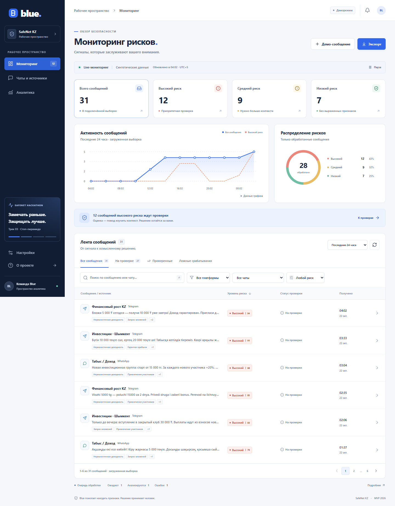

# Blue

Дашборд аналитика для SafeNet KZ, трек 3 «Стоп-пирамида». Blue показывает признаки возможной финансовой пирамиды, исходное сообщение и причины оценки. Окончательное решение принимает человек.



## Быстрый запуск

Нужен Node.js 22.12+ или 24 LTS.

```powershell
cd frontend
npm ci
npm run dev
```

Откройте http://127.0.0.1:5173. Демо работает без backend, ключей и базы данных.

## Что реализовано

- Мониторинг: High / Medium / Low, поиск, фильтры по платформе, чату, риску, статусу и времени; сортировка и пагинация.
- Обновление каждые 10 секунд с паузой, ручным обновлением, обработкой ошибок и уведомлением о новых сообщениях.
- Детали: исходный текст, точное выделение evidence, причины, объяснение, score, confidence и версия модели.
- Решение аналитика: NEW / REVIEWED / FALSE_POSITIVE и комментарий до 2000 символов. В демо сохраняется в localStorage, в API-режиме — POST-запросом.
- Статистика по чатам, платформам, признакам, очереди обработки и уровням риска.
- Экспорт отфильтрованной выборки в JSON с признаком синтетических данных.
- Настройки адреса API, проверка соединения, адаптивная вёрстка, маршруты с прямыми ссылками и поддержка клавиатуры.
- 31 синтетическое сообщение: русский, казахский, транслит, безопасные примеры и состояния PENDING / PROCESSING / ERROR. Кнопка «Демо-сообщение» добавляет новый сигнал для демонстрации live-ленты.

## Подключение FastAPI

1. Реализуйте ответы по [контракту API](docs/API.md).
2. Запустите backend на `http://127.0.0.1:8000`.
3. В Blue откройте **Настройки → Backend API**. Пустой адрес использует Vite proxy `/api` на порт 8000.
4. Нажмите «Проверить API», затем «Сохранить».

Можно указать другой адрес. При прямом обращении разрешите CORS для `http://127.0.0.1:5173` на backend. Пример переменных находится в `frontend/.env.example`. Локальные настройки браузера имеют приоритет над переменными окружения.

Сервер production должен отдавать `index.html` для клиентских маршрутов (`/alerts/*`, `/chats`, `/analytics`, `/settings`) и проксировать `/api`, либо использовать отдельный API-домен. `VITE_*` читаются при сборке; секреты в них помещать нельзя.

## Telegram и WhatsApp ingestion

FastAPI backend принимает события непосредственно на `/webhooks/telegram` и
`/webhooks/green-api`, сохраняет разрешённые сообщения через общий pipeline Blue и передаёт
их на AI-анализ. Подробности настройки и секретов описаны в `BACKEND_HANDOFF.md`.

## Проверки

```powershell
cd frontend
npm run build
npm test
```

Playwright по умолчанию использует установленный Google Chrome. Для другого окружения: `npx playwright install chromium`, затем `PLAYWRIGHT_CHANNEL=chromium npm test` (в PowerShell задайте `$env:PLAYWRIGHT_CHANNEL='chromium'` перед командой).

Тесты проверяют пользовательские сценарии и границу API: фильтры, review с сохранением, прямые ссылки, экспорт, смену источника, ошибки без подмены демоданными, polling и мобильные экраны. `npm test` автоматически запускает Vite или использует уже работающий на 5173 сервер.

## Границы frontend

AI-анализ, Telegram-бот, импорт WhatsApp и хранение на сервере относятся к модулям backend / AI. Демо-оценки заданы вручную и не являются показателями качества модели. Precision / recall / false-positive rate интерфейс не выдумывает. В API-режиме при сбое отображается ошибка, автоматического переключения на демо нет.

Счётчики на карточках приходят из `/api/stats`. Лента и статистика по чатам/признакам используют загруженную выборку `/api/alerts`. Сервер должен возвращать полный согласованный snapshot для MVP; серверная пагинация и push/WebSocket — следующий этап.

## Структура

```text
frontend/src/
  components/    общие элементы, графики, выделение evidence
  data/demo.ts   синтетические примеры и demo-review
  lib/           типы, Zod-схемы, API-клиент, polling
  pages/         мониторинг, детали, чаты, аналитика, настройки
frontend/tests/  браузерные сценарии и API fixtures
docs/API.md      контракт для backend и AI-разработчика
```

Стек: React, TypeScript, Vite, React Router, Zod, Lucide, Playwright. Дизайн: синий акцент Blue, тёмная навигация, светлая рабочая область, отдельные текстовые индикаторы риска. Используется системный шрифт без внешних запросов.
