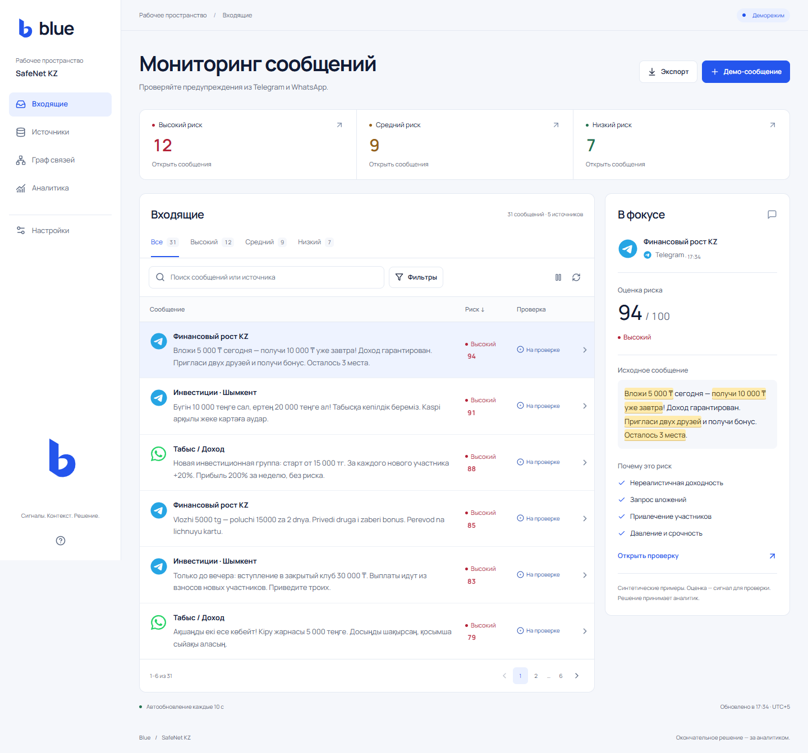
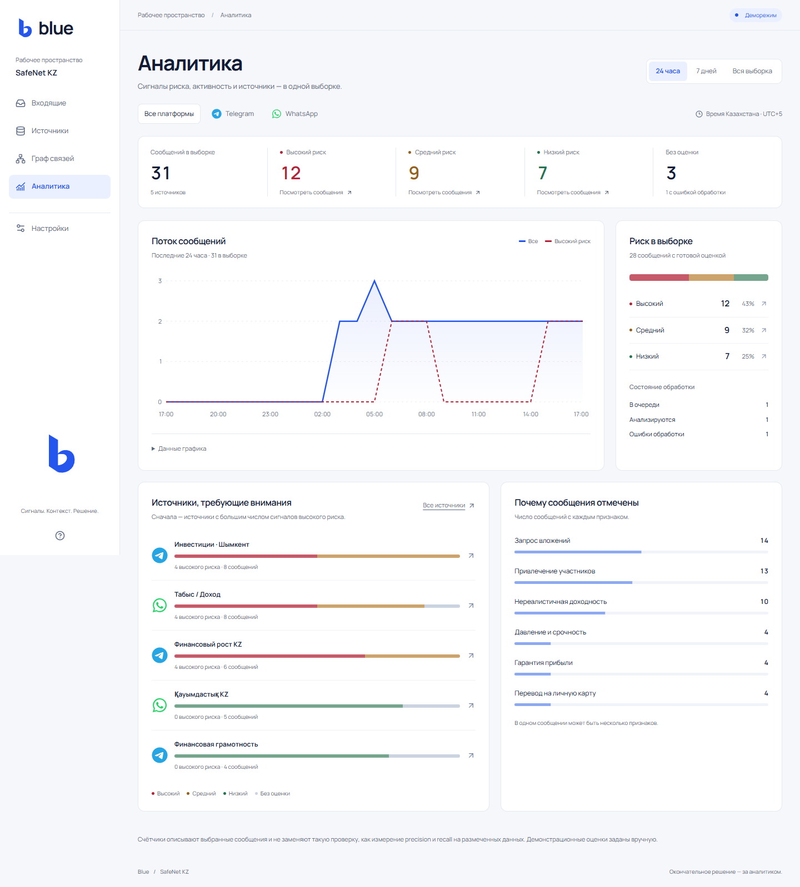
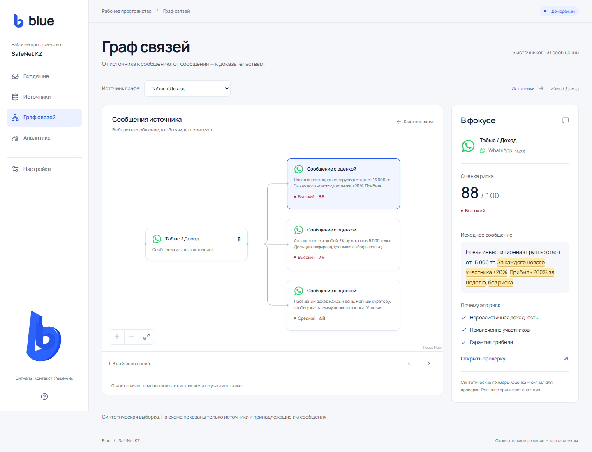
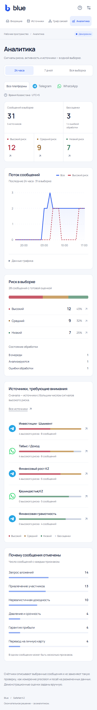
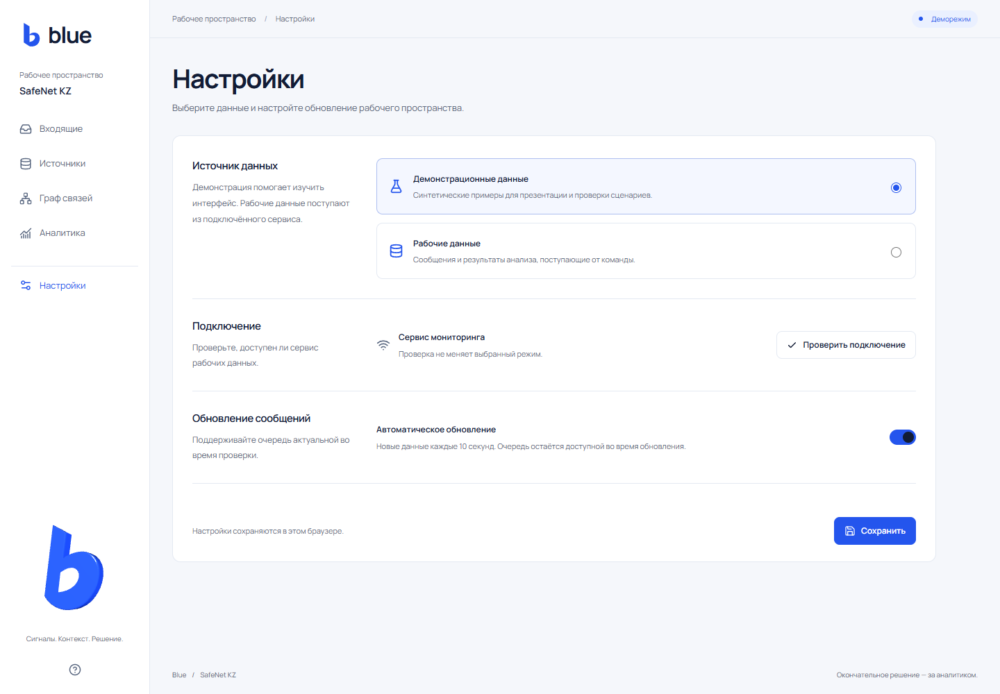

# Blue

Fly.io + Supabase synthetic demo setup and release gates: [docs/DEPLOY_FLY.md](docs/DEPLOY_FLY.md). Use `python run.py seed-demo` for the idempotent API seed; the legacy `seed` command clears records.

**SafeNet KZ · трек «Стоп-пирамида»**

Blue помогает аналитику проверять признаки финансовых пирамид в сообщениях Telegram и WhatsApp: найти предупреждение, прочитать исходный текст и доказательства, затем сохранить решение и комментарий.

Ветка `frontend` содержит React-приложение и контракт подключения к сервису данных. По умолчанию доступно демо без backend, ключей и внешних сервисов.



## Что доступно

| Экран | Возможности |
| --- | --- |
| **Входящие** | Карточки высокого, среднего и низкого риска; поиск; фильтры по платформе, источнику, риску, проверке и периоду; сортировка, страницы и экспорт текущей выборки в JSON. |
| **Проверка сообщения** | Исходный текст с точными выделенными фрагментами, причины оценки, объяснение, версия модели, решение и комментарий аналитика. Краткий контекст также открывается рядом со списком в панели «В фокусе». |
| **Источники** | Список чатов Telegram и WhatsApp с количеством сообщений и переходом к их выборке. |
| **Граф связей** | Подписанная схема «Blue → источник → сообщение»: выбор источника, масштабирование, по три сообщения на странице, контекст и переход к полной проверке. Доступны мышь, клавиатура и список сообщений. |
| **Аналитика** | Периоды 24 часа / 7 дней / вся выборка и фильтр платформы. Поток сообщений, распределение риска, обработка, источники и частые признаки используют одну выборку. У графика есть подсказки и таблица значений. |
| **Настройки** | Демонстрационные / рабочие данные, проверка подключения и автообновление с интервалом 10 секунд между загрузками. Адрес сервиса задаётся в конфигурации разработчика. |

Статусы обработки: `PENDING`, `PROCESSING`, `PROCESSED`, `ERROR`. Аналитик может оставить сообщение новым, отметить проверенным или ложным срабатыванием.

## Актуальные скриншоты

Сняты **23 октября 2026** с работающего приложения: desktop — 1440 px, мобильный экран — 390 px. Использованы синтетические демоданные. Это реальные снимки интерфейса; анимации для съёмки переведены в режим уменьшенного движения.

### Аналитика

Общая выборка для счётчиков и графика, цвета уровней риска, логотипы Telegram и WhatsApp, источники и причины предупреждений.



### Источник, сообщение и доказательства

Схема состоит из подписанных карточек. Соединение показывает принадлежность сообщения источнику; связь между участниками мошеннической сети на основании этой линии не устанавливается.



<details>
<summary>Мобильная аналитика</summary>

<p>Фильтры, сводка и график перестраиваются под узкий экран.</p>



</details>

<details>
<summary>Настройки рабочего пространства</summary>

<p>Выбор режима, проверка подключения и автообновление.</p>



</details>

## Быстрый запуск

Требуется Node.js **22.12+** или **24 LTS**.

```powershell
git clone --branch frontend https://github.com/NivaroCodes/Blue.git
cd Blue/frontend
npm ci
npm run dev
```

Откройте [http://127.0.0.1:5173/](http://127.0.0.1:5173/). Если репозиторий уже скачан, достаточно выполнить `npm ci` и `npm run dev` из каталога `Blue/frontend`.

### Сценарий демонстрации

1. Во входящих выберите высокий риск и откройте контекст сообщения.
2. Перейдите к полной проверке: прочитайте выделенные фрагменты и причины, сохраните решение с комментарием.
3. Откройте граф, выберите источник и сообщение — справа появятся доказательства.
4. В аналитике измените период или платформу: все блоки пересчитаются для выбранных сообщений.

Изначально в демо **31 синтетическое сообщение из 5 источников** на русском, казахском и транслите. Настройки и решения демо сохраняются в `localStorage` этого браузера.

## Подключение рабочих данных

Интегрированный сервис реализован в модуле `ai_data` в соответствии с [контрактом API](docs/API.md) на базе **PostgreSQL** и **Google Gemini** (`gemini-3.5-flash-lite`):

```powershell
# Запуск FastAPI сервера (порт 8000, требует PostgreSQL):
python run.py api

# Запуск фонового AI-воркера (PostgreSQL SKIP LOCKED + Google Gemini):
python run.py worker

# Заполнение базы данных тестовыми сценариями (PostgreSQL):
python run.py seed

# Запуск полного набора тестов (53 теста):
python run.py test
```

Frontend использует следующие эндпоинты:

| Метод | Путь | Назначение |
| --- | --- | --- |
| `GET` | `/api/alerts` | Полная выборка сообщений |
| `GET` | `/api/alerts/:id` | Одно сообщение |
| `GET` | `/api/stats` | Сводка по той же выборке |
| `POST` | `/api/alerts/:id/review` | Решение и комментарий аналитика |

Из каталога `frontend` скопируйте пример окружения:

```powershell
Copy-Item .env.example .env.local
```

При локальном backend на порту 8000 оставьте:

```dotenv
VITE_DATA_MODE=demo
VITE_API_BASE_URL=
API_PROXY_TARGET=http://127.0.0.1:8000
```

После изменения окружения перезапустите Vite. В **Настройки → Рабочие данные** проверьте подключение и сохраните выбор. Пустой `VITE_API_BASE_URL` означает запросы к `/api` на домене frontend; в режиме разработки Vite проксирует их на `API_PROXY_TARGET`.

Для отдельного API-домена задайте `VITE_API_BASE_URL=https://your-api.example.com` без завершающего `/api` и разрешите origin frontend в CORS сервиса. Переменные `VITE_*` попадают в клиентскую сборку: секреты в них не хранятся. Уже сохранённые настройки браузера имеют приоритет над начальными значениями окружения.

В production нужны возврат `index.html` для клиентских маршрутов и проксирование `/api` либо отдельный API-домен. Конфигурация Vite proxy применяется только к серверу разработки. Ошибка сервиса в рабочем режиме показывается пользователю; автоматической подмены на демо нет.

## Стек и устройство проекта

React 19, TypeScript, Vite, React Router; Zod для ответов API; Recharts для аналитики; React Flow для схемы; Motion для переходов; Three.js для фирменного знака. Шрифт Manrope поставляется локально. Telegram и WhatsApp — локальные SVG из Font Awesome Free Brands; [атрибуция](frontend/public/brands/README.md).

```text
frontend/
  public/brands/          Логотипы Telegram и WhatsApp
  src/components/        Общие элементы, график, схема и доказательства
  src/pages/             Входящие, проверка, источники, граф, аналитика, настройки
  src/lib/               API, схемы данных, загрузка и расчёты аналитики
  src/data/demo.ts       Синтетические примеры
  tests/                 Проверки Playwright
docs/
  API.md                 Контракт сервиса данных
  screenshots/           Скриншоты текущего интерфейса
```

Светлый интерфейс использует синий акцент и отдельные цвета риска. Короткие анимации карточек, графиков и соединений учитывают `prefers-reduced-motion`. Схема работает без WebGL; объёмный знак при отсутствии WebGL заменяется SVG. Аналитика, схема и Three.js загружаются отдельными модулями.

Заставку можно пропустить кнопкой или Escape и повторить через **О проекте → Посмотреть заставку**. Описание визуальной системы — в [DESIGN.md](DESIGN.md), продуктовые требования — в [PRODUCT.md](PRODUCT.md).

## Сборка и проверки

Из каталога `frontend`:

```powershell
npm run build
npm test
```

Сборка проверяет TypeScript и создаёт `frontend/dist`. Для локального просмотра сборки выполните `npm run preview` и откройте [http://127.0.0.1:4173/](http://127.0.0.1:4173/).

Playwright по умолчанию запускает установленный Google Chrome. Для Chromium:

```powershell
npx playwright install chromium
$env:PLAYWRIGHT_CHANNEL = 'chromium'
npm test
```

Проверки охватывают фильтры, экспорт, решения и комментарии, прямые ссылки, API-ответы и ошибки, polling, согласованность аналитики, графики, клавиатуру, схему, мобильную вёрстку и reduced motion. Последняя проверка от 23 октября: **40 тестов прошли**, production-сборка успешна. Добавлена защита сохранённого решения от запоздавших ответов, раздельные источники Telegram/WhatsApp с одинаковыми ID и единые временные фильтры; [подробности исправлений](docs/frontend-data-consistency-2026-10-23.md).

## Границы MVP

Оценки демосообщений заданы вручную для демонстрации интерфейса. Frontend сам не обучает модель, не подключается напрямую к чатам Telegram и не импортирует WhatsApp. Анализ AI, сбор сообщений и серверное хранение относятся к отдельному backend команды.

Карточки и графики описывают полученную выборку; они не являются измерением precision, recall или false-positive rate модели. Предупреждение — повод для проверки, окончательное решение принимает аналитик.


## Telegram voluntary-submission connector

The Telegram connector accepts private-chat submissions only. Ordinary messages are not stored or analyzed. Users must first send `/consent`, read the processing notice, explicitly grant consent with `/agree`, then submit each item with `/analyze text` or reply `/analyze` to a forwarded text message. Use `/revoke` to stop future analysis and `/delete_my_data` to delete records submitted under that pseudonymous Telegram identity.

Configure `TELEGRAM_BOT_TOKEN`, `TELEGRAM_WEBHOOK_SECRET`, `TELEGRAM_HASH_SECRET`, and `TELEGRAM_WEBHOOK_URL` in the API runtime environment. The endpoint is `POST /webhooks/telegram`; after deploying to a public HTTPS URL, run:

```bash
python -m ai_data.telegram_connector set-webhook
python -m ai_data.telegram_connector webhook-info
```

The MVP supports text and captions. The webhook records consent in PostgreSQL and passes explicitly submitted messages into the existing ingestion/worker pipeline. Telegram connector submissions are retained for at most 30 days; the worker periodically removes expired connector records and inactive consent records. Users can revoke consent or delete their submitted Blue records earlier. A PostgreSQL-backed API and an always-on background worker are required.

Before accepting real external users, configure an accessible privacy policy in @BotFather and verify encryption at rest for the database and backups. Until those hosting controls and the jurisdiction-specific privacy requirements are reviewed, use synthetic test data only.
